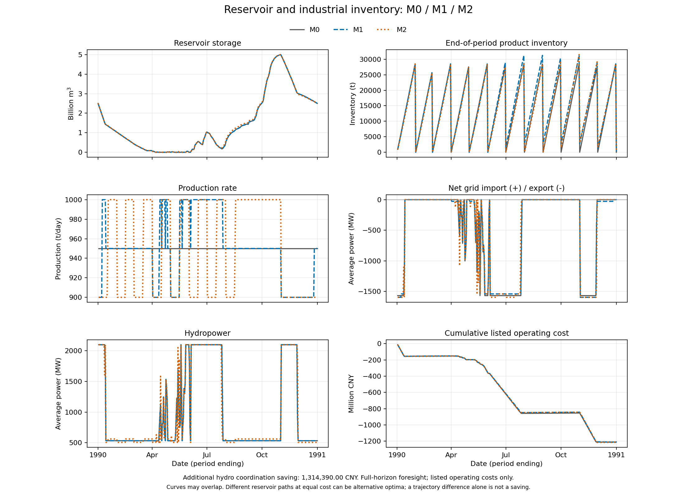

# v0 已运行结果与核验

这些文件记录 `configs/xiaowan_demo.json` 的一次实际运行，用于检查程序、量纲和数据流程。它们是给定假设下的代表性系统计算，不是小湾电站、某家铝厂的实际经营预测。

## 重现

在 `models/reservoir_inventory` 目录运行：

```bash
python -m pip install -e .
python -m unittest discover -s tests -v
python -m reservoir_inventory verify-toy --out outputs/toy
python -m reservoir_inventory demo --config configs/xiaowan_demo.json --out outputs/demo
python -m reservoir_inventory sweep --inputs outputs/demo/inputs/normal --out outputs/sweep
```

运行产生的完整输入表、逐日结果、周汇总和环境记录保存在 `outputs/`。这个目录只保留紧凑的示例结果，不手工编辑求解输出。原始入流和准备脚本来源见 `../data/source_manifest.json`。

## 核验结果

- 19 项单元及输入集成检查通过，含独立守恒与费用重算。
- 原仓库两期禁外送案例：M0/M1/M2 = `6 / 2.4 / 0.4`。
- 原仓库两期无限同价购售电案例：`4 / 0.4 / 0.4`，追加水电协调收益为零。
- 3 个完整日历年、9 次年度模型均求得最优解，1988 年保留 366 天。
- 平年输入的四类单因素敏感性共 22 点：20 点求得最优解，2 点输入不可行并保留原因，未以零收益代替不可行。
- 各次年度水量残差低于 `9e-7 m³`，能量残差低于 `8e-12 MWh`，产品残差低于 `2e-12 t`。这些是当前运行的数值残差，不是原始数据精度。

输入、源码 SHA-256、运行库版本与检查结果见 [validation_record.json](validation_record.json)。

## 三个代表年

费用差均以 CNY 计；CSV 保留更高精度。M1 分解依赖当前求解器选择的 M0 最优水电计划，不能视为唯一因果归因。

| 水文类别 | 年份 | 固定水库下的调整收益 M0−M1 | 追加水库协调收益 M1−M2 | 总改善 M0−M2 | M2 最大月末交付后库存 |
|---|---:|---:|---:|---:|---:|
| 枯 | 1993 | 29,828.56 | 386,571.44 | 416,400.00 | 0 t |
| 平 | 1988 | 91,280.22 | 327,219.78 | 418,500.00 | 0 t |
| 丰 | 1990 | 2,507,525.00 | 1,314,390.00 | 3,821,915.00 | 3,050 t |

默认系统允许净售电，三个方案的所列净运行费用均为负数。这里报告绝对费用差；未计入的固定成本、建设投资等不能据此当作零，也不能把负费用称为企业总利润。

完整小表见 [representative_years_summary.csv](representative_years_summary.csv)，平年单因素结果见 [sensitivity_normal.csv](sensitivity_normal.csv)。

## 这次初跑实际说明了什么

**枯年和平年的总改善可完全用月内延后生产、减少库存占用解释，尚未显示跨月备货的必要性。**

基准每日950 t，允许范围900—1000 t。一个有 n 天的月份，在月末交付不变时，先少产、后补足可减少 `50 × floor(n²/4)` t·day 的库存占用。平历年各月合计138,800 t·day，闰年139,500 t·day，乘持有费3 CNY/(t·day)，恰好得到416,400和418,500 CNY。两年 M2 的月末库存均为0，且峰值仓容仍为29,450 t，与基准正常周转峰值相同。

因此，平年把额外仓容从0天增至90天没有进一步增加收益；提高持有费使“少占用库存”的价值增加。不能将这些结果反过来解释为“库存越贵越应该备货”或“扩大仓库一定有价值”。

丰年 M2 有3,050 t的月末结转，约3.21天平均交付量，说明存在跨月库存；仅凭这个量还不能证明跨季备货，也不能把全部收益归因于季节库存。

## 敏感性中的两个输入不可行点

1. 库容乘0.25后只有1.25×10⁹ m³，放不下保留的2.5×10⁹ m³共同初末水量。代码保持绝对水量，报告输入不可行。
2. 额定产能为基准的1.15倍时，额定产能为1,092.5 t/day，90%最低生产量为983.25 t/day，已超过基准950 t/day。固定交付与初末库存下无法维持所要求的M0比较，代码报告输入不可行。

上述拒绝帮助区分“没有调节价值”和“比较条件不成立”。

## 丰年轨迹示例



图中曲线可能重合；最优解不唯一时，部分水库轨迹差异也可能只是同成本方案的区别。解释协调收益应同时检查费用、守恒和交付后库存。
